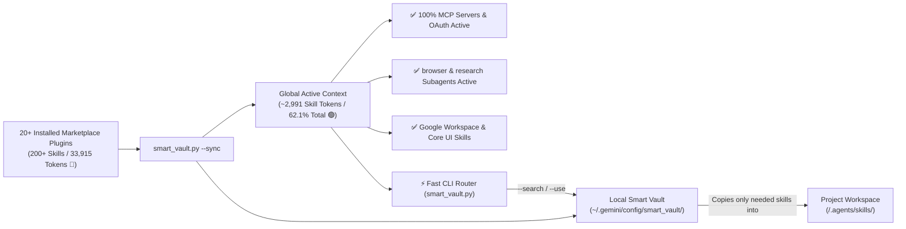

# ⚡ Antigravity Smart Skill Vault (`agy-smart-vault`)

> **Reduce Google Antigravity IDE Global Skill Token Overhead by 90% (`169.6% 🔴 → 62.1% 🟢`) while keeping 100% of your MCP Servers, OAuth Connections, Subagents (`browser`, `research`), and Google Workspace tools active.**  
> **Architected & Designed by:** **Elgasem** (`aljasmabrahym943@gmail.com`) — *co-developed with Google Antigravity*  
> **License:** Apache-2.0 with Mandatory Attribution (`NOTICE` & `CITATION.cff`) | **Contributions Welcome 🤝**

---

## 🌍 English Documentation | [📖 الشرح بالعربية بالأسفل](#-الدليل-العربي-الكامل-antigravity-smart-skill-vault)

### 🚨 The Problem: "Customization token budget exceeded" (`20,000` Token Limit)

When you install 15–20 official or partner plugins from the **Google Antigravity Marketplace** (such as *Flutter* [25 skills], *Neo4j* [30 skills], *Figma* [16 skills], *Firebase* [13 skills], *Spacefast* [13 skills], *invideo* [11 skills], *incident.io* [11 skills]) alongside standalone skill suites like *Firecrawl* [37 skills]:

1. **Global Context Overflow:** Even though Antigravity loads only `SKILL.md` YAML frontmatter descriptions, **180–200+ global skill descriptions alone consume `25,097+ tokens` (`125.5%` of the 20,000-token budget)** before you type a single word.
2. **Critical Subagent Eviction:** Because `Skills`, `Subagents`, and `MCP Tools` share the same `20,000-token` pool (`Other Customizations`), exceeding the budget automatically **evicts 60+ skills** AND **evicts core built-in subagents (`browser` and `research`)**!
3. **Rapid AI Quota Drain:** Sending ~34,000 tokens of unused global skill descriptions on every turn drains your AI usage limit across unrelated projects.
4. **Why "Disabling Plugins" Isn't Enough:** If you disable a plugin in the Plugins Manager, you also lose its active **MCP Server**, **OAuth Sign-In**, and **Subagents**.

---

### 💡 The Solution: Two-Tier Smart Skill Vault & Project-Scoped Routing (`.agents/skills/`)

**`antigravity-smart-vault`** solves this using Antigravity's native customization architecture with **zero external daemons**:



1. **Decouples Skills from Plugins without Disabling MCP/Subagents:** Moves bulky plugin skill folders out of global auto-discovery into `~/.gemini/config/smart_vault/` while keeping every plugin **`enabled: true`** in `config.json` (preserving all MCP tools, OAuth tokens, Rules, and Subagents).
2. **Instant `<20ms` Keyword Search (`--search`):** Indexes all vaulted skills into `vault_index.json` so the AI agent can search 189+ skills in `<20ms` using `<30 tokens` instead of loading 27,000+ tokens into every prompt.
3. **Project-Scoped Installation (`--use <skill> --project .`):** When a specific project needs a vaulted skill, the CLI copies it directly into that project's isolated **`<ProjectRoot>/.agents/skills/`** folder — **never polluting Global context for other projects!**

---

### 📊 Real-World Benchmark (Verified on Google Antigravity IDE)

| Metric | Before `agy-smart-vault` | After `agy-smart-vault` | Impact |
| :--- | :-: | :-: | :--- |
| **Global Skills Loaded** | `211` skills (`~30,730 tokens`) | `22` core skills (`~2,991 tokens`) | **🔥 90.3% Skill Token Reduction** |
| **Total `Other Customizations`** | 🔴 `33,915 / 20,000` (`169.6%`) | 🟢 `11,816 / 20,000` (`62.1%`) | **Saves ~27,739 skill tokens every turn** |
| **Excluded Skills & Subagents** | 🔴 `61 skills` + `2 subagents` (`browser`, `research`) | 🟢 **`0 excluded`** | **`browser` & `research` 100% restored** |
| **Active MCP Servers & OAuth** | `100%` | 🟢 **`100%`** | **Zero MCP plugins disabled** |

---

### 🚀 Quick Start (Windows / macOS / Linux)

Requires Python 3.8+ (zero external `pip` dependencies):

```bash
# 1. Sync bulky skills into the Smart Vault & generate the Global Router Skill + Rule
python smart_vault.py --sync

# 2. Check your live token savings & vault status
python smart_vault.py --status

# 3. Search for any vaulted skill in <20ms
python smart_vault.py --search "canva resize"

# 4. Scope a skill (or an entire plugin's skills) into a specific project's .agents/skills/
python smart_vault.py --use "spacefast" --project "/path/to/my-project"

# 5. Safe 1-Click Rollback (restores all skills back to Global at any time)
python smart_vault.py --restore
```

---

### 🤝 Open Collaboration & Contributing (The Door Is Open!)

**This project is open to everyone who wants to evolve this idea or contribute to it on GitHub!**  
Whether you want to add tech-stack auto-detection, semantic search, cross-IDE support (Gemini CLI, Claude Code, Cursor), or UI integrations — **Pull Requests, Issues, and new ideas are warmly welcomed**. See [`CONTRIBUTING.md`](./CONTRIBUTING.md) to get started.

---

## 🇸🇦 الدليل العربي الكامل (Antigravity Smart Skill Vault)

### 💡 فكرة المشروع والمشكلة التي يحلّها
عند تثبيت 15 إلى 20 إضافة من متجر **Google Antigravity** في الوضع العام (`Global`)، يتراكم أكثر من 200 ملف مهارة (`SKILL.md`) تستهلك أوصافها وحدها أكثر من **`25,097` توكن (`125.5%` من الميزانية)**، مما يؤدي إلى:
* ظهور خطأ **`Customization token budget exceeded (169.6%)`**.
* **طرد وحجب أكثر من 60 مهارة** و**تعطيل وكيل المتصفح (`browser`) ووكيل البحث (`research`)** تلقائياً.
* **استنزاف سريع جداً لرصيد الاستخدام (`AI Quota`)** في كل رسالة حتى في المشاريع التي لا تستخدم تلك الإضافات.

### ✨ كيف يحلّ `antigravity-smart-vault` هذه المشكلة جذرياً؟
1. **فصل المهارات الفرعية في «خزنة الفهرس الذكي» (`smart_vault`) دون إيقاف فيش الربط (`MCP`):** تبقى جميع الإضافات مفعّلة (`On`) وتبقى جميع فيش الربط (`MCP Tools`) والوكلاء الفرعيون (`Subagents`) وإضافات **Google الرسمية** شغالة 100%.
2. **بحث فوري في أقل من 20 جزءاً من الثانية (`--search`):** فهرس ذكي (`vault_index.json`) يسمح للذكاء الاصطناعي بالبحث عن أي مهارة واستدعائها عند الطلب فقط (بنسبة توفير وصلت إلى **`90.3%`**).
3. **التخصيص التلقائي داخل مجلد المشروع (`.agents/skills/`):** عند الحاجة لأي مهارة في مشروع معين، يتم نسخها داخل مجلد `.agents/skills/` الخاص بذلك المشروع فقط عبر الأمر `--use`، فلا تلوّث المجلد العام ولا تثقل المشاريع الأخرى أبداً.

### 🤝 المساهمة والتطوير المشترك (الباب مفتوح للجميع!)
**الباب مفتوح بالكامل لكل من يرغب في تطوير هذه الفكرة أو المشاركة في تحسينها على GitHub!**  
نرحّب بجميع المساهمات عبر **Pull Requests** و**Issues** لتطوير الأداة ودعم مزيد من الميزات والأدوات. يمكنك الاطلاع على دليل المساهمة في [`CONTRIBUTING.md`](./CONTRIBUTING.md).

---

## 🛡️ License & Mandatory Attribution (حماية الملكية الفكرية)

Copyright © 2026 **Elgasem** (`aljasmabrahym943@gmail.com`).

Licensed under the **Apache License, Version 2.0** (see [`LICENSE`](./LICENSE) and [`NOTICE`](./NOTICE)).  
Under **Section 4(d) of the Apache-2.0 License**, any redistribution, fork, modification, or derivative tool built upon this project **must retain the [`NOTICE`](./NOTICE) and [`CITATION.cff`](./CITATION.cff) files intact** with clear attribution to **Elgasem**.
