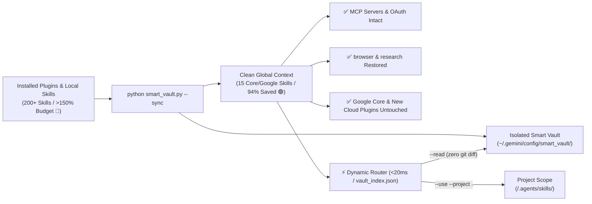

# ⚡ Antigravity Smart Skill Vault (`agy-smart-vault` v2.0.1)

> **Keep Google Antigravity fast, save your AI usage quota, and fix the red `Customization token budget exceeded` warning — cutting Global Skill token overhead by `90%+` while keeping your MCP servers, OAuth logins, Subagents (`browser`, `research`), and Google Workspace plugins untouched.**

**Created & Co-Developed by:** **Elgasem** & **Google Antigravity AI Agent**  
**License:** Apache-2.0 (`LICENSE` & `NOTICE`) | **[📖 الشرح العربي الكامل بالأسفل](#-الشرح-العربي-المبسّط-والشامل-للمبتدئ-وللخبير)**

---

## ✨ What's New in `v2.0.1` (Option A: Opt-In, Auto-Prune & Update-Safe)

1. **Strict Opt-In Policy for Cloud Plugins (`vault_policy.json`):** `--sync` **never** silently sweeps brand-new Marketplace plugins or touches Google core plugins (`gcalendar`, `gdocs`, `gdrive`, `gmail`, `gemini-api`, `google-antigravity-sdk`, etc.). Opt plugins in explicitly via `--vault-plugin <name>` (or one-time `--vault-all-plugins`) and restore any single plugin via `--unvault-plugin <name>`.
2. **Auto-Prune on Uninstall:** When you uninstall a plugin from Antigravity, `--sync` automatically removes its leftover vaulted skills and refreshes the catalog (zero ghost entries).
3. **Upstream Update Sync:** When an opted-in plugin receives a Marketplace update, `--sync` atomically replaces its vaulted copy — picking up new skills, updated docs, and removed skills cleanly.
4. **Disable vs. Uninstall Awareness (Read-Only `config.json`):** Temporarily disabling a plugin (`enabled: false`) hides it from the active `smart-skill-catalog` without deleting its vaulted files — and re-enabling brings it right back.
5. **Direct Ephemeral Read (`--read <skill>`):** Read any vaulted skill directly in the same turn with **zero `git status` pollution** in your project (use `--use` only when you want persistent `.agents/skills/` scoping).
6. **Permanent Delete (`--remove <skill>`) & Safe Rollback (`--restore`):** `--remove` deletes a skill from both active folders and the vault; `--restore` clears `opted_in_plugins` cleanly so scheduled background sync won't re-vault restored plugins.
7. **Silent Zero-Token Background Auto-Sync (`--sync --quiet`):** Atomic file writes + silent no-op when clean, ideal for Windows Task Scheduler (`pythonw.exe`) or macOS/Linux `cron`.

---

## 🧭 What Is This Tool? (Clear Guide for Both Beginners & Experts)

### 🌱 If You Are a Beginner (Plain Language — Zero Jargon)
Imagine your AI assistant works at a **desk** that holds **20,000 tokens** of tool instructions:
- Every time you install plugins from the Antigravity Marketplace (like Flutter, Figma, Canva, Neo4j, n8n, Firecrawl), each plugin puts **10 to 37 instruction cards (Skills)** on that desk — in **every single project** you open!
- Soon, the desk overflows (**`169.6%` full 🔴**). When that happens:
  1. **Your AI usage limit (Quota) drains much faster** on every message.
  2. **Important built-in tools stop working** — Antigravity automatically kicks out `60+` skills AND kicks out the **`browser`** and **`research`** assistants!
  3. **Turning off plugins isn't a good fix**, because turning off a plugin also disconnects its live tools (like Canva or Figma).

**What `antigravity-smart-vault` does:**
- Think of it as adding a **smart filing cabinet (`smart_vault`)** right next to the AI's desk, with **each plugin neatly isolated in its own drawer**.
- It moves heavy, rarely used skill cards off the desk and into the cabinet — **without deleting anything, without turning off a single MCP server or OAuth login, and without ever touching Google's core plugins!**
- Whenever you ask for something (like Canva, Figma, n8n, or Flutter), the AI opens the cabinet in **less than 0.02 seconds**, reads the exact skill directly (`--read`) without cluttering your repo, or copies it into that single project (`.agents/skills/`) when needed (`--use`).

---

### ⚙️ If You Are an Engineer / Expert (Technical Architecture)

When 15–20 multi-skill plugins are installed globally in `~/.gemini/config/`, YAML frontmatter descriptions alone exceed **`25,000–30,000 tokens` (`125%–150%`)**. Because `Skills`, `Subagents`, and `Lazy MCP Tools` share a single `20,000-token` `CustomizationTokenBudget`, Antigravity evicts dozens of skills and core built-in subagents (`browser`, `research`).

**`antigravity-smart-vault`** implements a zero-daemon **Two-Tier Progressive Disclosure & Opt-In Lifecycle Manager**:



1. **Plugin Skill Decoupling (Opt-In Only):** Manages opted-in non-Google plugins via `vault_policy.json` while keeping `mcp_config.json`, OAuth tokens, `rules/`, and `agents/` intact. Never writes to `config.json`.
2. **Sub-20ms Local Search & Same-Turn Read (`--search` / `--read`):** Queries `vault_index.json` in `<20ms` and loads only the exact requested `SKILL.md` ephemerally.
3. **Lifecycle Sync (`--sync`):** Auto-prunes uninstalled plugins, atomically refreshes updated opted-in plugins, hides temporarily disabled plugins (`enabled: false` in `config.json`), and auto-generates `smart-skill-catalog/SKILL.md`.
4. **Safe 1-Click Rollback (`--restore` / `--unvault-plugin`):** Restores skills cleanly and clears `opted_in_plugins`.

---

### 📊 Verified Real-World Impact (Measured Live in Antigravity)

| Metric | Before `agy-smart-vault` | After `agy-smart-vault` v2.0.1 | Improvement |
| :--- | :-: | :-: | :--- |
| **Global Skills Loaded** | `207+` skills (`~31,500+ tokens`) | `15` core/Google skills (`~1,901 tokens`) | **🔥 94.0% Skill Token Reduction** |
| **Excluded Skills & Subagents** | 🔴 `61 skills` + `browser` & `research` | 🟢 **`0 excluded`** | **`browser` & `research` restored** |
| **Active MCP Servers & OAuth** | `100%` | 🟢 **`100%`** | **Zero plugins or MCP servers broken** |
| **Google Core & New Cloud Plugins** | — | 🟢 **Protected by Policy** | **Never modified automatically** |

---

### 🚀 1-Minute Setup (Windows / macOS / Linux)

Only Python 3.10+ is needed — **zero external dependencies (`no pip install`):**

```bash
# 1. Clone this repository (or download smart_vault.py)
git clone https://github.com/aljasm-oss/antigravity-smart-vault.git
cd antigravity-smart-vault

# 2. Check current token usage & vault policy
python smart_vault.py --status

# 3. Opt in specific heavy non-Google plugins (or all non-Google plugins once)
python smart_vault.py --vault-plugin "figma"
# Or explicitly opt in all currently installed non-Google plugins once:
python smart_vault.py --vault-all-plugins

# 4. Sync local skills, plugin updates & auto-prune uninstalled plugins
python smart_vault.py --sync

# 5. Search or read any vaulted skill directly (zero git pollution!)
python smart_vault.py --search "canva resize"
python smart_vault.py --read "resize-for-social-media"

# 6. Scope a skill (or whole plugin) into ONE project only (.agents/skills/)
python smart_vault.py --use "flutter" --project "/path/to/your-project"

# 7. Restore a single plugin or undo everything cleanly
python smart_vault.py --unvault-plugin "figma"
python smart_vault.py --restore
```

#### ⏱️ Optional: Silent Automatic Background Sync (`0` Tokens / `0` Idle RAM)
- **Windows (Task Scheduler via PowerShell — zero console popup using `pythonw.exe`):**
  ```powershell
  $action = New-ScheduledTaskAction -Execute "pythonw.exe" -Argument '"C:\path\to\smart_vault.py" --sync --quiet'
  $t1 = New-ScheduledTaskTrigger -AtLogOn -User $env:USERNAME
  $t2 = New-ScheduledTaskTrigger -Once -At (Get-Date).AddMinutes(5) -RepetitionInterval (New-TimeSpan -Hours 6) -RepetitionDuration (New-TimeSpan -Days 3650)
  Register-ScheduledTask -TaskName "AntigravitySmartVaultSync" -Action $action -Trigger @($t1, $t2) -Force
  ```
- **macOS / Linux (`crontab -e`):**
  ```cron
  0 */6 * * * /usr/bin/python3 /path/to/smart_vault.py --sync --quiet
  ```

---

### 🤝 Contributors & Open Collaboration

This tool was built to help everyone get the best out of AI coding agents — **contributions from beginners and experts alike are always welcome!**  
Want to suggest an idea, improve docs, or add a feature? Open an **Issue** or **Pull Request** anytime — see [`CONTRIBUTING.md`](./CONTRIBUTING.md).

<table>
  <tr>
    <td align="center">
      <a href="https://github.com/aljasm-oss">
        <br />
        <sub><b>Elgasem</b></sub>
      </a><br />
      <sub>Creator & Architect</sub>
    </td>
    <td align="center">
      <a href="https://github.com/google-antigravity">
        <br />
        <sub><b>Google Antigravity</b></sub>
      </a><br />
      <sub>AI Co-Author</sub>
    </td>
  </tr>
</table>

---

## 🇸🇦 الشرح العربي المبسّط والشامل (للمبتدئ وللخبير)

### 🌱 ما هي هذه الأداة ببساطة؟
تخيّل أن الذكاء الاصطناعي في **Google Antigravity** يعمل على **«طاولة مكتب»** تتسع فقط لـ **`20,000` توكن** من بطاقات المهارات والأدوات:
* كلما ثبّتَّ إضافات ضخمة (مثل Flutter أو Figma أو Canva أو Neo4j أو n8n أو Firecrawl)، تضع كل إضافة **من 10 إلى 37 بطاقة مهارة** فوق الطاولة في **كل محادثة** حتى لو لم تستخدمها فيها!
* فتمتلئ الطاولة ويُستنزف الليمت بسرعة ويضطر البرنامج لطرد مهارات ووكلاء أساسيين مثل **`browser`** و**`research`**.

**كيف تحلّ `antigravity-smart-vault v2.0.1` المشكلة بأمان؟**
* تضيف **خزنة منظَّمة ومجزّأة (`smart_vault`)** — كل إضافة لها درج معزول خاص بها — وتبقي كل فيش الربط (`MCP`) وتسجيلات الدخول (`OAuth`) شغّالة بدون أي انقطاع.
* **حماية كاملة لقدرات Google والإضافات السحابية الجديدة (الخيار أ):** لا تقترب الأداة أبداً من إضافات Google الأساسية (`Gmail`, `Drive`, `Calendar`, `Gemini API`, `SDK`...)، ولا تسحب أي إضافة سحابية جديدة تلقائياً إلا بطلبك (`--vault-plugin`).
* **تنظيف وتحديث تلقائي:** عند حذف أي إضافة تُمسح مهاراتها من الخزنة تلقائياً، وعند تحديث إضافة مؤرشفة تُستبدل مهاراتها بالنسخة الجديدة تلقائياً، وعند **التعطيل المؤقت (`Disable`)** تُخفى من الفهرس النشط بدون حذف ملفاتها وتعود فور إعادة التفعيل!
* **قراءة مباشرة بلا فوضى (`--read`):** يقرأ الذكاء الاصطناعي المهارة المطلوبة مباشرة في نفس اللحظة دون نسخ ملفات داخل مشروعك أو تلويث `git status` (مع إبقاء خيار `--use` لتثبيت مهارات داخل مشروع محدد عند الرغبة).

---

## 💬 Contact & Feedback (التواصل والرسائل)

* **General Messages, Ideas & Collaborations:** [GitHub Discussions](https://github.com/aljasm-oss/antigravity-smart-vault/discussions)
* **Bug Reports & Feature Requests:** [GitHub Issues](https://github.com/aljasm-oss/antigravity-smart-vault/issues)

---

## 🛡️ License & Attribution (الحقوق والرخصة)

Copyright © 2026 **Elgasem** ([`@aljasm-oss`](https://github.com/aljasm-oss)) — *Co-developed with Google Antigravity AI Agent*.  
Licensed under **Apache License 2.0** (see [`LICENSE`](./LICENSE) & [`NOTICE`](./NOTICE)). Anyone is free to use, improve, and share this tool while retaining the [`NOTICE`](./NOTICE) and [`CITATION.cff`](./CITATION.cff) attribution files.
