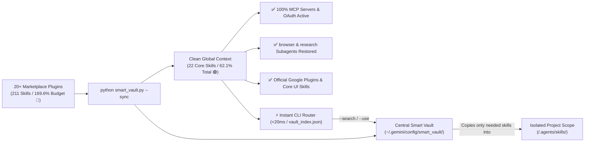

# ⚡ Antigravity Smart Skill Vault (`agy-smart-vault`)

> **Keep Google Antigravity IDE fast, save your AI usage quota, and fix the red `Customization token budget exceeded` warning — cutting Global Skill token overhead by `90.3%` while keeping `100%` of your MCP servers, OAuth logins, Subagents (`browser`, `research`), and Google Workspace tools working.**

**Created & Co-Developed by:** **Elgasem** & **Google Antigravity AI Agent**  
**License:** Apache-2.0 (`LICENSE` & `NOTICE`) | **[📖 الشرح العربي الكامل بالأسفل](#-الشرح-العربي-المبسّط-والشامل-للمبتدئ-وللخبير)**

---

## 🧭 What Is This Tool? (Clear Guide for Both Beginners & Experts)

### 🌱 If You Are a Beginner (Plain Language — Zero Jargon)
Imagine your AI assistant works at a **desk** that holds **20,000 tokens** of tool instructions:
- Every time you install plugins from the Antigravity Marketplace (like Flutter, Figma, Canva, Neo4j, Spacefast, Firecrawl), each plugin puts **10 to 37 instruction cards (Skills)** on that desk — in **every single project** you open!
- Soon, the desk overflows (**`169.6%` full 🔴**). When that happens:
  1. **Your AI usage limit (Quota) drains much faster** on every message.
  2. **Important built-in tools stop working** — Antigravity automatically kicks out `60+` skills AND kicks out the **`browser`** and **`research`** assistants!
  3. **Turning off plugins isn't a good fix**, because turning off a plugin also disconnects its live tools (like Canva or Figma).

**What `antigravity-smart-vault` does in 1 click:**
- Think of it as adding a **smart filing cabinet (`smart_vault`)** right next to the AI's desk.
- It moves the heavy, rarely used skill cards off the desk and into the cabinet — **without deleting anything and without turning off a single plugin or live connection!**
- Whenever you actually ask for something (like Canva or Flutter), the AI opens the cabinet in **less than 0.02 seconds**, grabs the exact skill card you need, and places a copy **only inside the project that needs it (`.agents/skills/`)**.
- **Result:** Your desk drops from **`169.6% 🔴` to `62.1% 🟢`**, your **`browser` & `research` tools immediately start working again**, and your AI quota lasts dramatically longer!

---

### ⚙️ If You Are an Engineer / Expert (Technical Architecture)

When 15–20 multi-skill plugins (e.g., *Flutter* [25], *Neo4j* [30], *Figma* [16], *Firebase* [13], *Spacefast* [13], *Firecrawl* [37]) are installed globally in `~/.gemini/config/`, YAML frontmatter descriptions alone exceed **`25,000–30,000 tokens` (`125%–150%`)**. Because `Skills`, `Subagents`, and `Lazy MCP Tools` share a single `20,000-token` `Other Customizations` pool, Antigravity evicts dozens of skills and core built-in subagents (`browser`, `research`).

**`antigravity-smart-vault`** introduces a native, zero-daemon **Two-Tier Progressive Disclosure & Project-Scoped Routing** pattern:



1. **Plugin Skill Decoupling (Zero MCP / OAuth Breakage):** Moves plugin `skills/` subdirectories (and root-level `*-skill` directories like Neo4j) into `~/.gemini/config/smart_vault/plugins/` while keeping every plugin **`enabled: true`** in `config.json` — preserving 100% of `mcp_config.json` servers, OAuth sessions, `rules/`, and `agents/`.
2. **Sub-20ms Local Index Search (`--search`):** Compiles all vaulted skills into `vault_index.json` so agents query 200+ skills in `<20ms` using `<30 tokens`.
3. **Automatic Project Scoping (`--use <skill-or-plugin> --project .`):** Installs needed skills exclusively into `<WorkspaceRoot>/.agents/skills/` rather than re-polluting Global discovery.
4. **Safe 1-Click Rollback (`--restore`):** Moves every vaulted skill back to its original global location cleanly at any time.

---

### 📊 Verified Real-World Impact (Measured Live in Antigravity IDE)

| Metric | Before `agy-smart-vault` | After `agy-smart-vault` | Improvement |
| :--- | :-: | :-: | :--- |
| **Global Skills Loaded** | `211` skills (`~30,730 tokens`) | `22` core/Google skills (`~2,991 tokens`) | **🔥 90.3% Skill Token Reduction** |
| **Total `Other Customizations`** | 🔴 `33,915 / 20,000` (`169.6%`) | 🟢 `11,816 / 20,000` (`62.1%`) | **Saves ~27,739 skill tokens per turn** |
| **Excluded Skills & Subagents** | 🔴 `61 skills` + `2 subagents` (`browser`, `research`) | 🟢 **`0 excluded`** | **`browser` & `research` 100% restored** |
| **Active MCP Servers & OAuth** | `100%` | 🟢 **`100%`** | **Zero plugins or MCP servers disabled** |

---

### 🚀 1-Minute Setup (Windows / macOS / Linux)

Only Python 3.8+ is needed — **zero external libraries to install (`no pip install`):**

```bash
# 1. Download this repository (or just download smart_vault.py)
git clone https://github.com/aljasm-oss/antigravity-smart-vault.git
cd antigravity-smart-vault

# 2. Organize heavy global skills into the Smart Vault (100% safe & reversible)
python smart_vault.py --sync

# 3. See your instant token savings report
python smart_vault.py --status

# 4. Search any vaulted skill in <20ms
python smart_vault.py --search "canva resize"

# 5. Copy a skill (or a whole plugin's skills) into ONE project only (.agents/skills/)
python smart_vault.py --use "spacefast" --project "/path/to/your-project"

# 6. Want to undo everything at any time? Run:
python smart_vault.py --restore
```

---

### 🤝 Contributors & Open Collaboration

This tool was built to help everyone get the best out of AI coding agents — **contributions from beginners and experts alike are always welcome!**  
Want to suggest an idea, improve docs, or add a feature? Open an **Issue** or **Pull Request** anytime — see [`CONTRIBUTING.md`](./CONTRIBUTING.md) (no complicated hoops!).

**Core Contributors:**
* **Elgasem** (`@aljasm-oss`) — Problem Discovery, Architecture & Product Direction
* **Google Antigravity AI Agent** — Collaborative Engineering, Implementation & Verification
* *Your name can be next — PRs and ideas are always open!* 🌟

---

## 🇸🇦 الشرح العربي المبسّط والشامل (للمبتدئ وللخبير)

### 🌱 ما هي هذه الأداة ببساطة؟ (شرح للمبتدئين بدون مصطلحات معقدة)
تخيّل أن الذكاء الاصطناعي في برنامج **Google Antigravity** يعمل على **«طاولة مكتب»** تتسع فقط لـ **`20,000` توكن** من بطاقات تعريف المهارات والأدوات:
* كلما ثبّتَّ إضافات من المتجر (مثل Flutter أو Figma أو Canva أو Neo4j أو Spacefast أو Firecrawl)، تضع كل إضافة **من 10 إلى 37 بطاقة مهارة** فوق هذه الطاولة — في **كل مشروع** تفتحه حتى لو لم تستخدمها فيه!
* والنتيجة أن الطاولة تمتلئ وتفيض (**`169.6%` 🔴**)، فيحدث 3 مشاكل مزعجة:
  1. **يُستنزف رصيدك من استخدام الذكاء الاصطناعي (`Quota`) بسرعة كبيرة** مع كل رسالة.
  2. **تتوقف أدوات أساسية عن العمل تلقائياً** — يقوم البرنامج بطرد أكثر من `60` مهارة وطرد **وكيل المتصفح (`browser`)** و**وكيل البحث (`research`)**!
  3. **وإيقاف الإضافات ليس حلاً جيداً**، لأنك إذا أطفأت الإضافة تنقطع معها وصلة الربط الحية (`MCP`) وتسجيل الدخول.

**كيف تحلّ أداة `antigravity-smart-vault` المشكلة بضغطة واحدة؟**
* تخيّل أننا نضع **«خزنة فهرس ذكية» (`smart_vault`)** بجانب طاولة الذكاء الاصطناعي.
* تنقل الأداة بطاقات المهارات الثقيلة غير المستخدمة يومياً من الطاولة إلى الخزنة — **دون حذف أي ملف، ودون فصل أي إضافة أو فيش ربط (`MCP`)، ومع إبقاء كل إضافات Google الرسمية شغالة 100%!**
* وعندما تطلب في أي محادثة استخدام أداة معينة (مثل Canva أو Flutter أو Spacefast)، يبحث الذكاء الاصطناعي في الخزنة في **أقل من 0.02 ثانية**، يسحب المهارة المطلوبة، ويضع نسخة منها **داخل ذلك المشروع فقط (`.agents/skills/`)** حتى لا تثقل باقي مشاريعك!
* **النتيجة الفورية:** ينزل ضغط الطاولة من **`169.6% 🔴`** إلى **`62.1% 🟢`** (توفير **`90.3%`** من توكنات المهارات!)، ويعود **وكيل المتصفح (`browser`) ووكيل البحث (`research`)** للعمل فوراً، وتستطيع استعادة الوضع السابق في أي وقت بأمر واحد (`--restore`).

### 🤝 المساهمون والتطوير المشترك (الباب مفتوح للجميع بكل بساطة!)
صُنعت هذه الأداة بالتعاون المشترك بين **`Elgasem`** و**`Google Antigravity AI Agent`** لخدمة المجتمع، **والباب مفتوح بالكامل للجميع دون أي تعقيد** — سواء كنت مبتدئاً لديك فكرة مفيدة أو مبرمجاً تريد إضافة ميزة جديدة عبر **Issues** أو **Pull Requests**. راجع [`CONTRIBUTING.md`](./CONTRIBUTING.md).

---

## 🛡️ License & Attribution (الحقوق والرخصة)

Copyright © 2026 **Elgasem** (`aljasmabrahym943@gmail.com`) — *Co-developed with Google Antigravity AI Agent*.  
Licensed under **Apache License 2.0** (see [`LICENSE`](./LICENSE) & [`NOTICE`](./NOTICE)). Anyone is free to use, improve, and share this tool while retaining the [`NOTICE`](./NOTICE) and [`CITATION.cff`](./CITATION.cff) attribution files.
